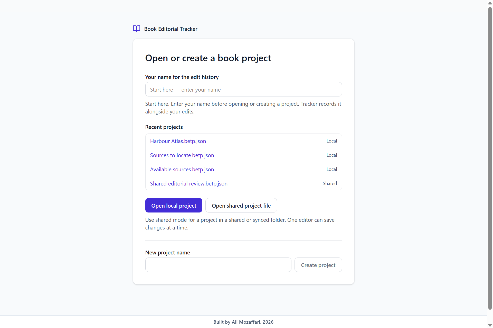
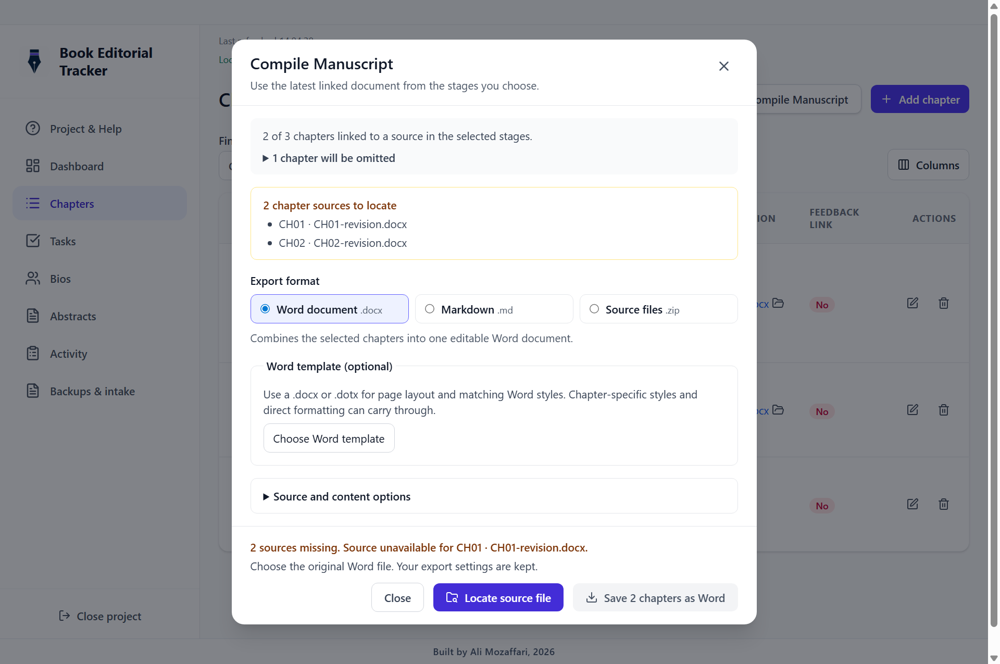

# Book Editorial Tracker

Book Editorial Tracker is a Windows desktop application for managing chapter metadata, editorial stages, manuscript references and activity history. Version 0.3.0 adds Word compilation and template support, recent projects and deletion undo.

## Download

Download the Windows portable package from [GitHub Releases](https://github.com/alimozaffari-stack/Book-Editorial-Tracker/releases). Extract the ZIP and open **Book Editorial Tracker.exe**. Enter your name for the edit history, then create a project or open a recent local or shared project.

## Storage choices

- Local project file: one editor at a time.
- Shared-folder project: one editor at a time; later conflicting saves are blocked, not merged.

Both modes store tracker data in a portable project file. Source Word documents remain separate. This build contains no owner Firebase configuration and exposes local/shared storage only.

## Working with a project

Enter your editor label and create or open a project. Use Backups & intake to download a chapter-list template, review a CSV/JSON import, export backups, or scan an existing folder. Selected source documents/folders are never edited, renamed, moved, or deleted by the application.

Scanning proposes chapter metadata for review. It does not automatically add stage history. Add stage records from chapter details after reviewing the relevant document. Open document and Show in folder require the source to be available on this computer.

From **Chapters**, choose **Compile Manuscript** to export a Word document, Markdown file or ZIP of source files. You can select a Word .docx or .dotx template for page layout and matching styles. The compiler checks selected sources before saving and helps locate missing files.

Deleted chapters can be restored with **Undo deletion** while the project remains open. Multiple deletions can be undone in reverse order.

## Saving and recovery

Successful edits persist to the project file. Shared mode verifies the editor lock before writes. Rejected stale saves leave the disk file intact and retain attempted changes for Save As conflict copy. A conflict copy opens in local mode; reconcile it explicitly with the shared project later.

Export JSON backups regularly. Backups contain tracker data, not manuscript documents. Starting a new project requires a JSON backup in the current session and confirmation in Project & Help. It creates a new project generation and clears the reviewed chapter inventory. CSV exports support reporting and chapter import; they do not restore every project field.

## Release validation

Follow [RELEASING.md](docs/RELEASING.md). Run the full source test suite, type check, public build and explicit archive check. Exercise create/edit/save/reopen, backup/restore and shared locking with synthetic data in the packaged application. Distribute only the resulting checked package, its hashes and acceptance record.

The executable may be unsigned; signing and Windows trust behaviour must be reported from actual checks. Do not include project files, locks, user-data, token caches, logs or development attachments in a release.

## More information

- [User guide](docs/USER_GUIDE.md)
- [Source-available non-commercial licence](LICENSE)
- [Changelog](CHANGELOG.md)
